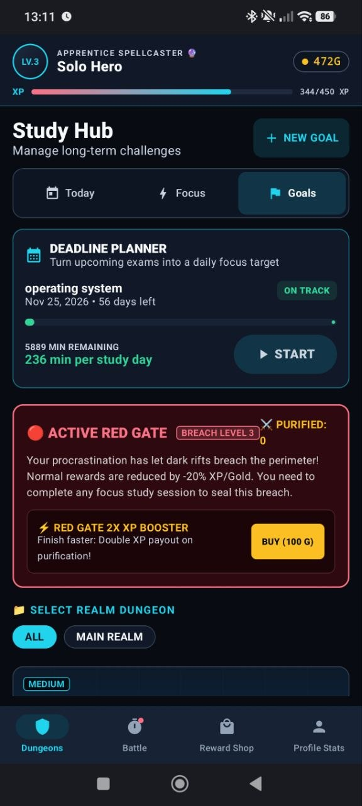
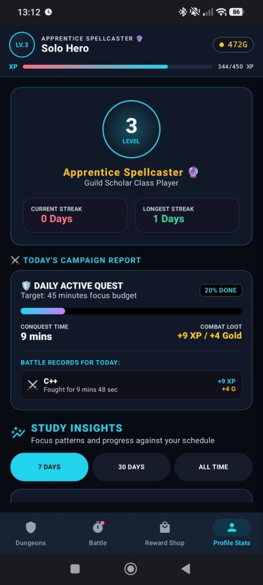
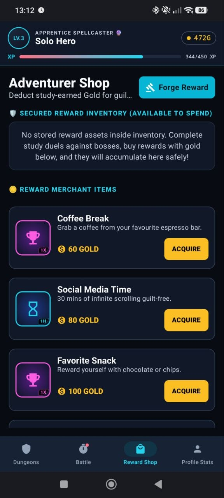

# Solo Studying

Solo Studying is an offline Android study timer that turns learning goals into
RPG-style campaigns. A study session damages a selected boss, earns experience
and gold, and records progress against the skill being trained.

The project is a work in progress. Its current focus is a reliable local-first
gameplay loop rather than accounts, cloud sync, or online services.

## Screenshots

Real-device screenshots from an earlier build, shared by the project author.
They show study goals, profile progress, and the reward shop. Navigation and
page organization have since changed; these are not screenshots of the latest build.

<table>
  <tr>
    <th>Study goals</th>
    <th>Profile &amp; progress</th>
    <th>Reward shop</th>
  </tr>
  <tr>
    <td></td>
    <td></td>
    <td></td>
  </tr>
</table>

## What works

- First-run setup for goals, study days, and daily targets
- Dungeons for grouping related goals
- Course-sized dungeon plans with hour targets, finish dates, custom study days, and adaptive daily estimates
- Boss battles and free-study sessions
- Independent goal sessions with 25/45/60-minute presets, custom durations, and daily-plan suggestions
- Offline guided exam planner with course effort estimates, daily capacity, weekly sessions, progress credit, and confirmed rescheduling
- Goal-linked planner subjects with editable names, five priority levels, named colors, optional deadlines, and saved weekly-hour preferences
- Weekly availability with multiple local-time windows per day, half-hour editing, rest days, and daily capacity ceilings
- Local start/end times inside accepted study windows, with exact-minute sessions and overlap-safe rescheduling
- Optional weekly study goals with priority-weighted sessions, saved course limits, and honest unscheduled-work warnings
- Deadline-aware daily study requirements and 15-minute budget comparisons showing accumulated spare time or shortages before saving
- Weekly course sessions inside Today, with direct start, credited progress, and a confirmed "No time today" rescheduling preview
- One-tap focus presets that remember the last duration and skill
- Personalized daily dashboard with prioritized next actions and target progress
- Home-screen widget for today's progress, next action, streak, and quick focus
- Weekly streak widget with daily target states and an original study companion
- Daily study quests with priorities, rollover, history, and timer integration
- Recurring study quests for daily routines or selected weekdays
- Goal checklists with timed study steps, progress tracking, and automatic completion
- Pause, resume, abandon, and completion flows
- Live focus notifications with countdown, pause, resume, and finish controls
- Post-session summaries for time, rewards, levels, streaks, and progress
- Optional post-session break timers with persistent countdowns and completion alerts
- Optional alarm-style timer completion screen, bounded vibration, silent-mode support and a test preview
- Weekly, monthly, and lifetime study insights with goal and period comparisons
- Independent skill progression based on focused time
- Custom real-life rewards purchased with earned gold
- Streaks, level progression, and recovery challenges
- Configurable local reminders based on schedule and current progress
- Low-latency sci-fi interface sounds for study and progression feedback
- Persistent sound enable and volume controls
- Local persistence with Room

## Timer completion alarms

Open **Settings > Timer completion alarm** and enable the optional switch.
Use **Allow lock-screen alerts** on Android 14+ and **Allow precise timers** on
Android 12+ when offered. Notification permission and the timer channel must also
remain enabled. **Test alert now** previews the screen without recording study
or changing the active timer. In silent/vibrate mode no chime plays. Dismiss stops
the feedback; it also stops automatically within 30 seconds. Android controls
whether a lock-screen activity or a notification is shown. See
[timer alarm behavior and phone tests](docs/TIMER_ALARM_SCREEN.md).

## Find your way around

- **Today**: daily progress, planned sessions, and expandable daily tasks.
- **Study**: Goals for long-term courses, Focus for quick sessions, and Plan for weekly scheduling.
- **Rewards**: your inventory and reward shop.
- **Profile**: separate Overview, Skills, and History sections.
- **Settings**: open the gear icon for study schedules, reminders, sound, breaks, and focus controls.

The timer opens when you start a session. If you leave its screen, a session bar
lets you return without ending your study. Existing focus-navigation warnings remain in place.
Your data stays on your device. See [the layout contract](docs/APP_ORGANIZATION.md).

In **Study → Plan**, open the weekly planner and choose **Subjects** to manage
course details without renaming or deleting the linked goals. Edit answers or
confirm **Rebuild remaining** to apply priority and deadline changes to a schedule.
Preferred weekly hours remain separate from total remaining effort and cap the
weekly schedule when a weekly goal is set. See [subject settings](docs/PLANNER_SUBJECTS.md).

Choose **Availability** in the same planner to set Monday–Sunday study windows.
Enable a day, open **Edit windows**, and enter local 24-hour start/end times in
30-minute steps, or use the duration slider. Add separate windows for breaks;
adjacent windows are allowed but overlapping or overnight windows are not.
Use 24:00 only as an end time. Each day supports up to eight study hours.
**Done** updates the weekly draft; **Save availability** persists it. Cancel
discards the draft. Disabled days retain their windows without adding capacity.

Saving windows does not move accepted sessions. Use **Edit answers** or confirm
**Rebuild remaining** to apply their capacity. Budget comparisons cannot exceed
these daily ceilings. An all-rest week can be saved, but cannot generate a plan.
Without saved windows, existing daily-minute settings continue to work as before.
With saved windows, newly accepted plans assign local start/end times to each
session. Old plans stay date-only until explicitly edited or rebuilt. Without
saved windows, the date-and-duration flow remains available.
See [availability settings](docs/PLANNER_AVAILABILITY.md).

The weekly view and Today show planned clock times without restricting when you
can study. Times and accepted windows persist across reopening. No time today
finds complete free slots without moving other sessions or changing study credit.
Choose **Move** on an unstudied timed session to select its date and local start
time. The editor previews the end time and rejects overlaps, dates outside the
course horizon and accepted capacity limits. Cancel never saves the draft.
See [timed sessions](docs/PLANNER_TIMED_SESSIONS.md).

In **Edit answers**, the session-length step also offers **Break length
(minutes)** for timed plans. Choose 0–30 whole minutes; 0 keeps the previous
no-gap schedule. Preview and save explicitly to apply it. Natural gaps between
windows count toward the minimum, with no required break before the first or
after the last session of a day. Break intervals appear separately in the preview
and weekly timetable; they never count as study, credit, weekly goals or rewards,
and do not start the break timer automatically.

Generation and manual add/move/resize actions honor the same gap. Locked slots
stay fixed; incompatible locks block saving. Capacity estimates allow for breaks,
but course boundaries and locked slots can reduce usable study time further.
Review the actual sessions and unscheduled work before accepting a plan. Old
plans are unchanged until explicitly edited and saved. See
[planned breaks](docs/PLANNER_BREAKS.md).

Choose **Lock session** to keep an unstudied timed slot fixed during rebuilding
and answer edits. Locked slots reserve their full duration against daily, weekly
and course limits. Conflicts are explained without replacing the accepted plan.
Use **Unlock session** before moving a slot, postponing a locked day, or
rebuilding past/studied locks. Locking never prevents starting study early and
does not lock the phone. See [session locks](docs/PLANNER_SESSION_LOCKS.md).

Use **Edit duration** on an unstudied, unlocked timed session to choose 1–120
minutes without changing the preferred generated length. Review the new end time,
week totals and every later session that will be shortened or removed before
**Apply change**. Only the same course's later-day, unstudied, unlocked time can
be transferred. Shortening returns time to unscheduled work, not completed study.
Cancel saves nothing. See [duration editing](docs/PLANNER_SESSION_DURATIONS.md).

Use **Add session** in a timed weekly plan to choose a course, date, local start
and 1–120 minutes from that course's unscheduled work. Review the slot and
remaining work before saving. Other sessions are never shortened automatically.
**Remove session** returns an unstudied, unlocked slot to unscheduled work after
confirmation; it does not complete the work or remove its course. Manual sessions
are labeled separately. Lock them to preserve their slots through rebuilding;
an explicit rebuild replaces unlocked manual sessions. See
[custom sessions](docs/PLANNER_CUSTOM_SESSIONS.md).

Use **Change subject** on an unstudied, unlocked timed session to assign its
fixed date, time and duration to another unfinished course in the accepted plan.
Review both courses' unscheduled minutes before confirming. The selected course
needs enough unscheduled work, a matching deadline and room in its saved weekly
limit. Other sessions, recorded study credit and rewards stay unchanged. See
[session subjects](docs/PLANNER_SESSION_SUBJECTS.md).

In **Schedule → Create weekly plan / Edit answers**, enter an optional weekly
study goal in the availability step. Preview actual weekly sessions based on
priority, finish dates, remaining effort and course weekly limits. Review any
unscheduled work before saving. Old plans stay unchanged until you edit and save
or confirm a rebuild. Moves and postponements respect accepted weekly limits;
see [weekly sessions](docs/PLANNER_WEEKLY_SESSIONS.md).

## Tech stack

- Kotlin
- Jetpack Compose and Material 3
- Room with Kotlin Symbol Processing
- Coroutines, Flow, and StateFlow
- MVVM with feature-specific view models
- AlarmManager and BroadcastReceiver for reminders
- Chronometer-based Android notifications for background focus controls
- Robolectric and JUnit for local tests

The bundled interface sounds come from Kenney's CC0 Interface Sounds pack.

Focus and break completion use a two-short/one-long vibration cue and the bundled
completion chime. Silent/vibrate modes use vibration only; app sound settings
control the chime. DND suppresses both cues. Foreground and background delivery
share duplicate protection, even when notification permission is denied.
See [timer completion alerts](docs/TIMER_COMPLETION_ALERTS.md) for phone checks
and Android background-delivery limitations.
See [`THIRD_PARTY_NOTICES.md`](THIRD_PARTY_NOTICES.md) for the source, license,
and file mapping.

## Architecture

```text
Compose screens
      |
SoloStudyingViewModel
      |
Feature view models (battle, status, dungeon, skill, shop)
      |
SoloStudyingRepository
      |
Room DAO and SQLite database
```

`SoloStudyingViewModel` is the interface used by the Compose layer. It delegates
feature behavior to smaller view models while the repository keeps database
access in one place.

## Run locally

### Requirements

- Android Studio with support for Android Gradle Plugin 9.1
- Android SDK 36.1
- JDK 21 (the JDK bundled with current Android Studio works)
- An emulator or Android device running API 24 or newer

### Setup

1. Clone the repository:

   ```bash
   git clone https://github.com/amkumirab/solo-studying-app.git
   cd solo-studying-app
   ```

2. Open the folder in Android Studio.
3. Allow Gradle to sync and download the declared dependencies.
4. Select the `app` configuration and run it on an emulator or device.

No API key or online account is required. Study data stays in the app's local
Room database.

## Plan a long-term course

Open **Dungeons > Goals**, select a dungeon, then choose **Set study target and
deadline**. Enter total study hours, pick a date (or use the **2 months** shortcut),
and choose your study weekdays. **Plan a dungeon** also lets you start with a new
course name. Assign bosses to that exact dungeon name to record course progress.

The plan card shows total progress, remaining effort, and the suggested pace per
remaining study day. Existing and completed boss progress counts; free study does
not. Editing or removing a plan leaves bosses and their recorded time intact.
See [Dungeon study plans](docs/DUNGEON_STUDY_PLANS.md) for calculation rules.

## Tests

Run the local JVM test suite from Android Studio or the project root.

macOS/Linux:

```bash
bash ./gradlew testDebugUnitTest
```

Windows:

```powershell
.\gradlew.bat testDebugUnitTest
```

The core test suite covers onboarding, persistence, boss progress, rewards,
session summaries, streak behavior, and tutorial completion.

## Build and install a debug APK

On Windows, build the app from the repository root:

```powershell
.\gradlew.bat lintDebug assembleDebug
```

The APK is created at `app/build/outputs/apk/debug/app-debug.apk`. With USB
debugging enabled and the device authorized, install or update it with:

```powershell
adb devices
adb install -r app/build/outputs/apk/debug/app-debug.apk
```

## Repository layout

```text
app/src/main/java/com/amkumirab/solostudying/
├── data/
│   ├── dao/
│   ├── database/
│   ├── entity/
│   └── repository/
├── notification/
├── sound/
└── ui/
    ├── screens/
    ├── theme/
    └── viewmodel/
```

Product rules and implementation boundaries are documented in
[`docs/PRODUCT_OVERVIEW.md`](docs/PRODUCT_OVERVIEW.md).

## Current limitations

- Data is stored on one device; export and sync are not implemented.
- Some Compose screens are still large and will be split into feature files as
  the UI evolves.
- Release signing is intentionally left to the developer's local configuration.

## Next steps

- Split the main Compose screen by feature
- Add data export and restore
- Improve accessibility labels and UI tests
- Record a short walkthrough of the study workflow

## License

Copyright (c) 2026 Amir Ali Mirab Zadeh Ardekani. All rights reserved.

The source code may be downloaded, compiled, installed, and run only for
personal, non-commercial evaluation and testing. Modification, redistribution,
publication, commercial use, and derivative works are not permitted without
prior written permission. See the [Evaluation-Only License](LICENSE) for the
complete terms. This is not an open-source license.
